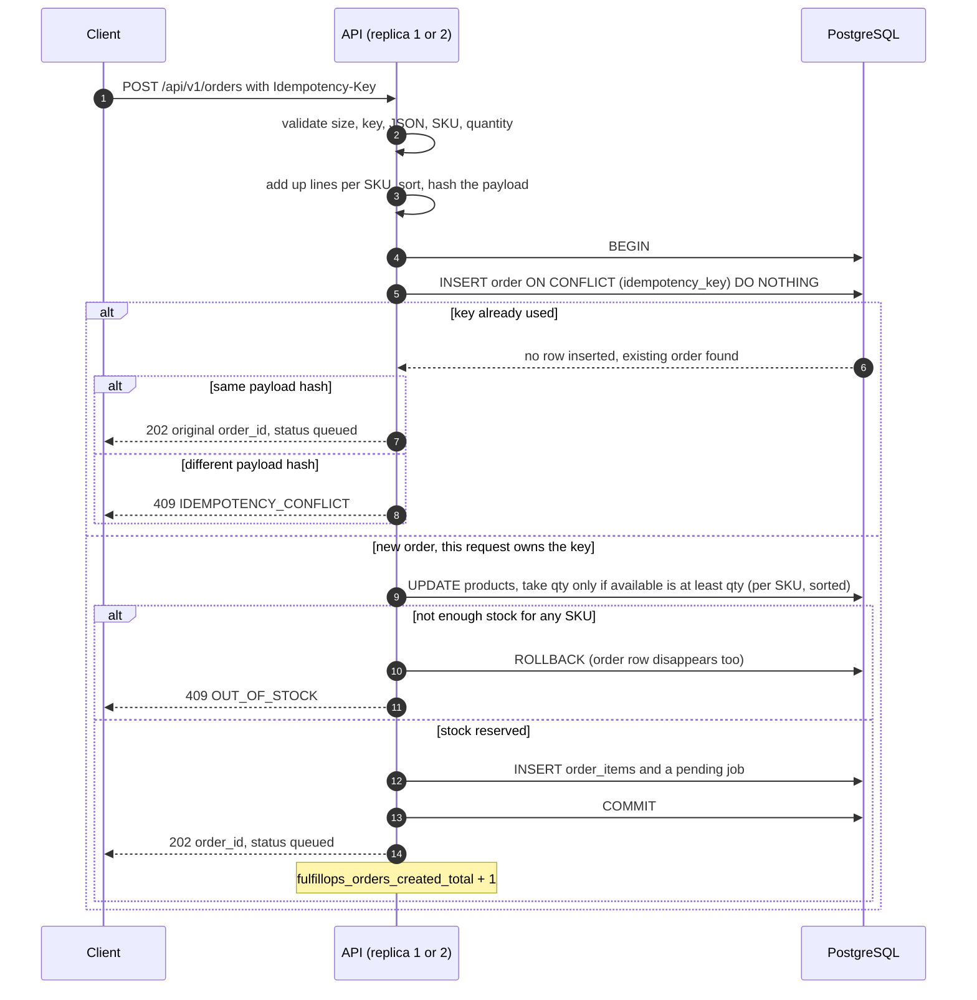
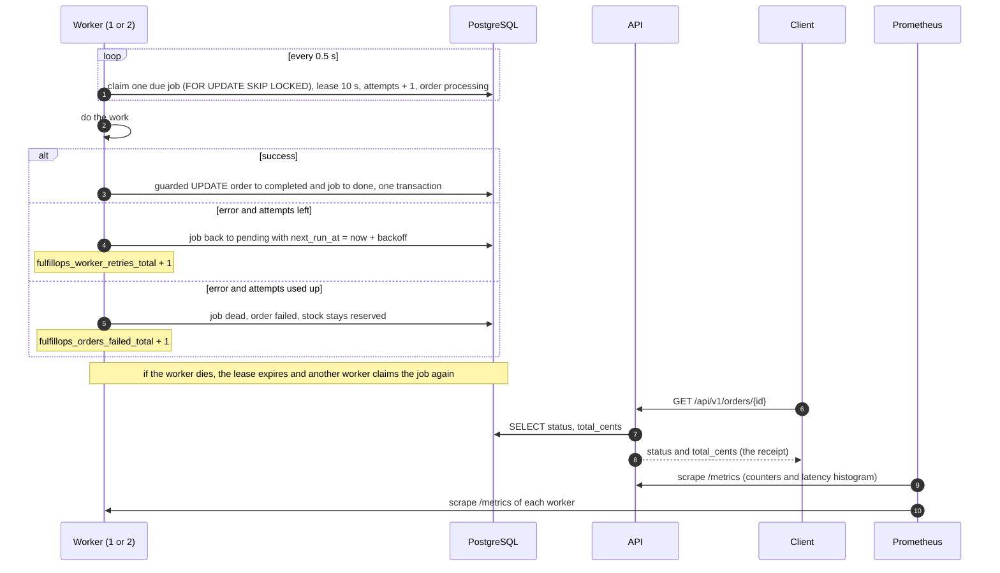

# ADR-001: Architecture of FulfillOps (API, worker, PostgreSQL)

###### documention: Okoene Makuo
- **Scope:** how orders are accepted, how stock is reserved, how jobs reach the worker, and how failures are handled

## 1. Context

FulfillOps accepts customer orders over HTTP, reserves stock exactly once, and lets a separate
worker finish each order asynchronously. Clients retry. Several clients may buy the last units at
the same moment. Two API replicas and two workers run against one durable store. A worker or an
API pod may be killed at any time, and no accepted order may disappear.

The API contract (`API_CONTRACT_EN.md`) is fixed. The implementation language, database layer and
queue mechanism are our choices and must be justified here.

## 2. Invariants and the mechanism that enforces each

| # | Invariant | Mechanism |
|---|-----------|-----------|
| I1 | `available >= 0` always | `CHECK (available >= 0)` on `products`, plus one conditional `UPDATE ... WHERE available >= qty` per SKU |
| I2 | One idempotency key maps to at most one order | `UNIQUE (idempotency_key)` on `orders`, inserted with `ON CONFLICT DO NOTHING` |
| I3 | A replay with a different payload is rejected | `payload_hash` stored with the order and compared on every replay (409 `IDEMPOTENCY_CONFLICT`) |
| I4 | An order is never completed twice | Guarded completion: `UPDATE orders SET status='completed' WHERE id=$1 AND status <> 'completed'`, in the same transaction that marks the job `done`, only while the worker still holds the lease |
| I5 | A committed order cannot vanish if a worker restarts | The order, its lines, the stock decrement and its `jobs` row commit in one transaction; an expired lease makes the job claimable again |
| I6 | 202 is returned only after durable creation | The response is sent after `COMMIT` |
| I7 | A permanently failing job is auditable and not silently undone | After the last attempt the job becomes `dead`, the order `failed`, and the stock stays reserved (no automatic restock) |

## 3. Decisions

Each decision records what was chosen, why, what else could have worked, and which requirement
it satisfies.

### D1. Stack: Python, FastAPI, PostgreSQL 16, psycopg 3 with plain SQL
- **Why:** the public checker is Python, one language covers API, worker, tests and scripts, and
  PostgreSQL provides the transactions and unique constraints that stay correct across replicas.
  Plain SQL keeps the transaction boundary visible and easy to explain.
- **Alternative:** Node/TypeScript with the same database; SQLAlchemy or asyncpg instead of
  psycopg.
- **Requirement:** WP2 (stock reserved inside a database transaction); individual oral defense.

### D2. Code structure: layered transaction script, one package, one image
- **Chosen:** `src/fulfillops/{api,worker,common}`. Routes call one `create_order` function that
  holds the whole transaction; a thin `common/db.py` (pool and helpers) is shared by the API and
  the worker. API and worker are two commands of the same image.
- **Why:** the safety of the system sits in one transaction, so keeping it in one function makes
  it readable top to bottom. A single image means one build, one scan and one SBOM.
- **Alternative:** hexagonal architecture with repositories and a Unit of Work (cleaner to test
  with fakes, but more files and more time); separate `api/` and `worker/` folders with two images.
- **Requirement:** WP2; WP5 (reproducible images); oral defense.

### D3. Transaction style: local ACID transaction at acceptance
- **Chosen:** order, order lines, stock decrement and the `pending` job are written in one
  PostgreSQL transaction. The worker completes the order in a second, separate transaction.
- **Why:** both processes share one database, so the database itself guarantees all-or-nothing.
  Acceptance is strongly consistent; completion is eventually consistent (seconds).
- **Alternative:** a saga with compensating actions, or two-phase commit. Both are meant for
  several databases or services and would add failure modes here.
- **Requirement:** WP2 (202 after durable creation); Advanced A (an accepted order never vanishes).

### D4. Queue: `jobs` work table claimed with `FOR UPDATE SKIP LOCKED` and leases
- **Chosen:** the job row is created in the order transaction (this is a transactional outbox in
  which the table itself is the queue). Workers poll about every 0.5 s and claim a row atomically,
  setting `locked_by`, `lease_expires_at` and incrementing `attempts`. A row whose lease has
  expired is claimable again.
- **Exactly-once effect on at-least-once delivery:** a job can be delivered more than once (for
  example when a worker dies after working but before marking `done`). The guarded completion in
  I4 makes the business effect happen once anyway.
- **Why:** no extra service to deploy, order and job commit together, crash recovery is one SQL
  condition.
- **Alternative:** transactional outbox with a relay and Redis Streams or RabbitMQ; or publishing
  to a broker after commit, which can lose a job between commit and publish.
- **Requirement:** Advanced A (durable at-least-once, reclaim after a worker dies, two workers).

### D5. Stock locking: conditional `UPDATE` under READ COMMITTED
- **Chosen:** for each SKU, in sorted order,
  `UPDATE products SET available = available - $qty WHERE sku = $sku AND available >= $qty`.
  Zero rows updated means not enough stock: roll back everything and answer 409 `OUT_OF_STOCK`.
- **Why:** check and decrement are one atomic step on a locked row; concurrent requests wait and
  re-check the latest value. Sorting SKUs gives every transaction the same lock order, so there
  are no deadlocks. The `CHECK` constraint is the last line of defense.
- **Alternative:** `SELECT ... FOR UPDATE` then update; an optimistic version column; SERIALIZABLE
  isolation with a retry loop.
- **Requirement:** WP2; Advanced B; the checker's race test accepts only 202 or 409.

### D6. Idempotency: unique key plus stored payload hash
- **Chosen:** the request lines are added together per SKU and sorted, then hashed (SHA-256 of
  canonical JSON). `INSERT ... ON CONFLICT (idempotency_key) DO NOTHING RETURNING id` decides the
  winner. A request that finds the key already used compares hashes: equal returns 202 with the
  original `order_id`; different returns 409.
- **Why:** the unique index is the arbiter across replicas and restarts; no process-local state.
- **Alternative:** an advisory lock per key, a Redis lock, or a process-local mutex (rejected by
  the brief).
- **Requirement:** Advanced B (eight simultaneous identical requests create one order).

### D7. Retry policy: bounded, with backoff, then dead-letter
- **Chosen:** 5 attempts counted at claim time; delays of about 2 s, 4 s, 8 s and 16 s with
  +/-25 % jitter and a 30 s cap; lease 10 s. When attempts are used up the job is `dead`, the
  order is `failed`, `last_error` is stored, the failure metric is incremented, and the stock is
  not restocked.
- **Why:** transient faults get time to clear, retries do not synchronize, a crash-looping job is
  also bounded because the attempt is counted at claim, and a poison job reaches `failed` in about
  30 s, which is short enough to demonstrate.
- **Alternative:** 3 fixed attempts (too weak) or 10 attempts with long backoff (demo too slow).
- **Requirement:** Advanced A; `fulfillops_worker_retries_total`.

## 4. Data flow

How to read the diagrams: each arrow is one message, numbered in time order. "Client" is any
caller, "API" is replica 1 or 2, "Worker" is worker 1 or 2, and "DB" is PostgreSQL. Everything
the API and the worker need to remember is stored in the DB, never in process memory.

### 4.1 Accepting an order (request, validation, one transaction, 202)

### 4.2 Processing the order (claim, work, completion or retry, receipt, metrics)

### 4.3 The same flow as a chain

`request` → `validation` → `one transaction (order, items, stock, job)` → `202 queued` →
`worker claim (lease)` → `completion (guarded update)` → `receipt (GET order)` → `metrics`

## 5. Alternatives considered

| Area | Alternative | Why we did not choose it | When it would be the better choice |
|------|-------------|--------------------------|------------------------------------|
| Stack | Node/TypeScript; SQLAlchemy or asyncpg | The checker and our scripts are Python; plain psycopg SQL keeps the transaction visible | A team that is stronger in JavaScript, or a large codebase that needs an ORM |
| Code structure | Hexagonal architecture with Repository and Unit of Work; domain model (DDD) | More files and indirection for rules that are simple; little time before the deadline | A long-lived product, several databases or queues, or heavy unit testing with fakes |
| Transactions | Saga with compensating actions; two-phase commit | Both are for several databases or services; we have one database, so they only add failure modes | Stock and orders in separate services with separate databases |
| Queue | Transactional outbox with a relay and Redis Streams or RabbitMQ; publishing to a broker after commit | Extra components to deploy and monitor; publishing after commit can lose a job in the gap | High throughput, many consumers, or services that must not share a database |
| Stock locking | `SELECT ... FOR UPDATE` then update; optimistic version column; SERIALIZABLE isolation | Two statements and a longer lock; retries and errors under contention; the checker accepts only 202 or 409 | Row-level logic that cannot be written as one conditional update |
| Idempotency | Advisory lock per key; Redis lock; process-local mutex | The unique index already decides the winner across replicas; a local mutex is rejected by the brief | Keys that must be coordinated with a system outside PostgreSQL |
| Retries | 3 fixed attempts; 10 attempts with long backoff | Too weak against longer faults; or a poison job takes minutes to show as failed | A real external dependency with known recovery times |
| Image layout | Separate images for API and worker | Two builds, two scans and two SBOMs for the same code | Very different dependencies or release cycles per process |

## 6. Consequences

- Acceptance is strongly consistent; completion is eventually consistent.
- One PostgreSQL instance is a single point of failure; acceptable for the lab, noted in the report.
- Polling adds a small constant load on the database; at this scale it is negligible.
- A `failed` order keeps its reserved stock until an operator reconciles it by hand.
- Out-of-stock rolls back the order row, so that idempotency key can be reused for a later attempt.
- Worker counters live in the worker processes, so each worker exposes its own `/metrics` (or the API
  reads the counts from the `jobs` table); this is to be settled with Person B.
- The contract does not state the response for a request body over 16 KiB; we answer 400
  `INVALID_REQUEST` and will confirm with the instructor.

## 7. Limitations

Each row states the issue, why it exists in this project, why it should change in a real system,
and the better solution. These are the limitations to mention in the report and in the defense.

| Limitation | Why it exists now | Why it should change | Better solution |
|------------|-------------------|----------------------|-----------------|
| One PostgreSQL instance (one pod, one volume) | One database gives a simple local ACID transaction (D3) and fits a local kind cluster | If it is down, no order can be accepted (readiness fails); losing the disk loses all orders | Replicated PostgreSQL with automatic failover, regular backups and point-in-time recovery |
| Workers poll the `jobs` table every 0.5 s | No broker to deploy (D4) | Constant database load that grows with the number of workers, and a latency floor of about 0.5 s | `LISTEN/NOTIFY` to wake workers, or an outbox relay feeding a broker for high throughput |
| A `failed` order keeps its stock reserved until a person acts | The brief forbids automatic restock and double fulfilment (I7) | Stock stays locked and there is no tool or alert for the operator | An operator runbook or admin action with an audit log to retry or release, and an alert on dead jobs |
| Idempotency keys never expire | The mapping must survive restarts (I2) and the contract defines no retention | The `orders` table grows forever and a key can never be reused | A retention window (for example 24 hours to 30 days) with a cleanup job, documented to clients |
| An out-of-stock request rolls back its order row, so the same key can later succeed | No partial allocation and no half-created order (D5) | A client that retries after a 409 may get a 202 later, which some clients would not expect | Store the rejected outcome and replay the 409 for that key if strict replay semantics are required |
| Stock safety depends on every write using the conditional update | Simple and explainable (D5); the CHECK only blocks negative stock | A future code path that writes `available` differently could break I1 or double-reserve | Keep all stock changes in one function, cover it with the race tests, or move it into a stored procedure |
| The lease is a fixed 10 s with no renewal | The simulated work is short (D7) | A long job would be reclaimed while still running, wasting work (the guarded completion still prevents a second effect) | A heartbeat that extends the lease while the worker is alive |
| No authentication, rate limiting or per-customer quota | The contract defines none | Anyone who can reach the API could drain stock or flood it | API keys or OAuth, rate limiting at a gateway, quotas per customer |
| `/metrics` is open inside the lab network | Lab only; the contract asks for the endpoint | It exposes operational data to anyone on the network | Separate port, Kubernetes NetworkPolicy, and authentication or mTLS at the ingress |
| The worker's "work" is simulated | There is no real fulfilment system in the project | Real side effects (emails, shipping calls) would be duplicated by at-least-once delivery | Send the order ID as an idempotency key to every external call, and publish events through the outbox |

## 8. Out of scope for this ADR

Threat model (`docs/threat-model.md`), CI/CD, Kubernetes and Argo CD (see their own documents).
