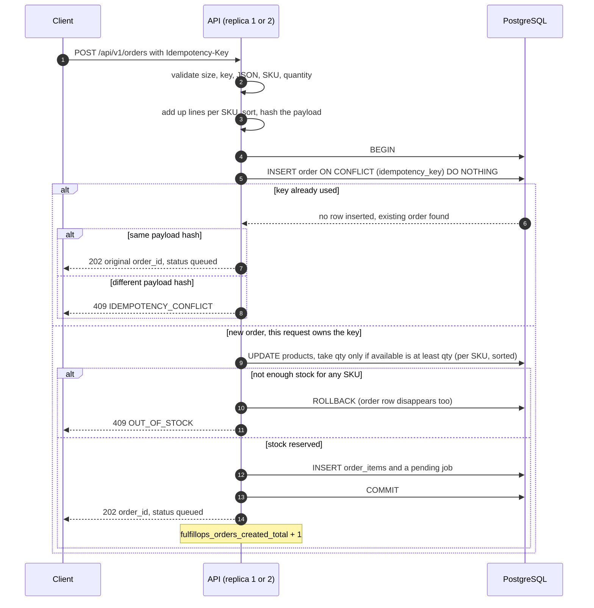
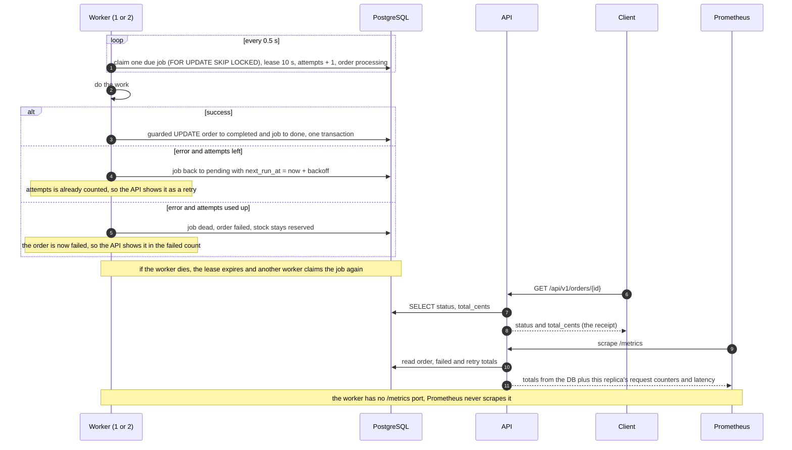

# ADR-001: How FulfillOps is built (API, worker and PostgreSQL)

these 3 lines especially written by person A and all these person's so---needs ro be handles
- **Status:** Proposed. Person B and Person C review it in the pull request.
- **Date:** 2026-11-10
- **Written by:** Person A

## 1. Context

FulfillOps takes customer orders over HTTP, reserves the stock once, and lets a separate worker
finish each order a bit later. Clients retry their requests. Several clients can try to buy the
last items at the same time. We run two API replicas and two workers on one database, and any of
them can be killed at any moment. An accepted order must never disappear.

The API contract (`API_CONTRACT_EN.md`) is fixed. The language, the database layer and the queue
are our choice, so this document explains what we picked and why.

## 2. Rules the system must always follow

| # | Rule | How we make sure |
|---|------|------------------|
| I1 | Stock never goes below 0 | A `CHECK (available >= 0)` on `products`, and one conditional `UPDATE ... WHERE available >= qty` per SKU |
| I2 | One idempotency key gives at most one order | A `UNIQUE (idempotency_key)` on `orders`, inserted with `ON CONFLICT DO NOTHING` |
| I3 | Reusing a key with a different body is refused | We store a `payload_hash` and compare it on every replay (409 `IDEMPOTENCY_CONFLICT`) |
| I4 | An order is never completed twice | The completion update only works if the order is not already completed and the job is still claimed by the same worker id and the same attempt number, in the same transaction that marks the job `done` |
| I5 | A committed order can't vanish if a worker restarts | The order, its lines, the stock change and its job are committed in one transaction, and a job whose lease expired can be claimed again |
| I6 | We only answer 202 after the data is safely saved | The response is sent after `COMMIT` |
| I7 | A job that keeps failing stays visible and is not silently undone | After the last attempt the job is `dead`, the order is `failed`, and the stock stays reserved (no automatic restock) |

## 3. Decisions

For each decision we write what we chose, why, what else could have worked, and which
requirement it covers.

### D1. Stack: Python, FastAPI, PostgreSQL 16, psycopg 3 with plain SQL
- **Chosen:** Python with FastAPI, PostgreSQL 16, and psycopg 3 writing plain SQL (no ORM).
- **Why:** The public checker is in Python, so one language covers the API, the worker, the tests
  and the scripts. PostgreSQL gives us transactions and unique constraints that stay correct with
  several replicas. Plain SQL keeps the transaction visible and easy to explain.
- **Alternative:** Node/TypeScript with the same database, or SQLAlchemy / asyncpg instead of
  psycopg.
- **Requirement:** WP2 (stock reserved inside a database transaction) and the oral defense.

### D2. Code structure: layered transaction script, one package, one image
- **Chosen:** The code lives in `src/fulfillops/{api,worker,common}`. The routes call one
  `create_order` function that holds the whole transaction. A small `common/db.py` (pool and
  helpers) is shared by the API and the worker. The API and the worker are two commands of the
  same image.
- **Why:** What keeps the system safe is one transaction, so keeping it in one function lets us
  read it from top to bottom. One image means one build, one scan and one SBOM.
- **Alternative:** Hexagonal architecture with repositories and a Unit of Work (easier to test with
  fakes, but more files and more time), or separate `api/` and `worker/` folders with two images.
- **Requirement:** WP2, WP5 (reproducible images) and the oral defense.

### D3. Transactions: one local ACID transaction when we accept an order
- **Chosen:** The order, its lines, the stock change and the `pending` job are written in one
  PostgreSQL transaction. Later, the worker completes the order in a second, separate transaction.
- **Why:** The API and the worker share one database, so the database itself guarantees
  all-or-nothing. Accepting an order is strongly consistent. Completing it is eventually
  consistent (a few seconds).
- **Alternative:** A saga with compensating actions, or two-phase commit. Both are made for
  several databases or services, and here they would only add ways to fail.
- **Requirement:** WP2 (202 only after the data is saved) and Advanced A (an accepted order never
  vanishes).

### D4. Queue: a `jobs` table with `FOR UPDATE SKIP LOCKED` and leases
- **Chosen:** The job row is created in the same transaction as the order. It is a transactional
  outbox where the table itself is the queue. Workers check the table about every 0.5 s and claim
  a job in one atomic step, which sets `locked_by` and `lease_expires_at` and adds 1 to
  `attempts`. A job whose lease expired can be claimed again.
- **Exactly once on top of at-least-once:** A job can be delivered more than once, for example if
  a worker dies after doing the work but before marking it `done`. The guarded completion from
  I4 makes sure the result still happens only once.
- **Why:** No extra service to deploy, the order and its job are saved together, and recovering
  from a crash is one SQL condition.
- **Alternative:** An outbox with a relay and Redis Streams or RabbitMQ, or publishing to a
  broker after the commit, which can lose a job in the gap between the two.
- **Requirement:** Advanced A (durable at-least-once delivery, reclaim after a worker dies, two
  workers).

### D5. Stock locking: one conditional `UPDATE` under READ COMMITTED
- **Chosen:** For each SKU, in sorted order, we run
  `UPDATE products SET available = available - $qty WHERE sku = $sku AND available >= $qty`.
  If it changes 0 rows, there isn't enough stock: we roll everything back and answer 409
  `OUT_OF_STOCK`.
- **Why:** The check and the decrement happen in one step on a locked row. Requests that arrive at
  the same time wait for each other and re-check the latest value. Sorting the SKUs means every
  transaction locks rows in the same order, so there are no deadlocks. The `CHECK` constraint is
  the last safety net.
- **Alternative:** `SELECT ... FOR UPDATE` then update, a version column (optimistic locking), or
  SERIALIZABLE isolation with a retry loop.
- **Requirement:** WP2, Advanced B, and the checker's race test (it only accepts 202 or 409).

### D6. Idempotency: a unique key plus a stored hash of the body
- **Chosen:** We add up the lines per SKU, sort them and hash them (SHA-256 of canonical JSON).
  `INSERT ... ON CONFLICT (idempotency_key) DO NOTHING RETURNING id` decides who wins. A request
  that finds the key already used compares the hashes: same hash gives 202 with the original
  `order_id`, different hash gives 409.
- **Why:** The unique index decides the winner across replicas and restarts, and we keep nothing
  in the memory of one process.
- **Alternative:** An advisory lock per key, a Redis lock, or a mutex inside one process (the
  brief rejects that one).
- **Requirement:** Advanced B (eight identical requests at the same time create one order).

### D7. Retries: limited, with backoff, then a dead-letter state
- **Chosen:** 5 attempts, counted when the job is claimed. The waits between attempts are about
  2 s, 4 s, 8 s and 16 s, with plus or minus 25 % random jitter and a 30 s cap. The lease is 10 s.
  When the attempts run out, the job becomes `dead`, the order becomes `failed`, `last_error` is
  saved, the failure metric goes up, and the stock is not given back.
  A job whose lease expires on its last attempt is marked `dead`, and its order `failed`, by the
  next worker loop.
- **Why:** A short problem gets time to clear, retries don't all hit at the same moment, a job
  that keeps crashing its worker also runs out of attempts, and a poison job reaches `failed` in
  about 30 s, which is quick enough to show in a demo.
- **Alternative:** 3 fixed attempts (too weak) or 10 attempts with long waits (too slow for the
  demo).
- **Requirement:** Advanced A and `fulfillops_worker_retries_total`.

### D8. Database access: a synchronous psycopg pool, migrations at startup under a lock
- **Chosen:** `psycopg_pool` with at most 20 connections per process and plain `def` routes (each
  request borrows one connection and runs its whole transaction). The pool opens without
  waiting, so the process and `/health/live` start even when PostgreSQL is down. Migrations run
  when the API starts, on their own autocommit connection that holds `pg_advisory_lock`. Each file
  runs in its own transaction together with its row in `schema_migrations`.
- **Why:** With no `await`, the order transaction reads from top to bottom and the worker can use
  the same helper. 20 connections cover the checker's 12 parallel requests, and a request that
  waits is better than a 500. The lock lets two replicas start together without migrating twice,
  and readiness can check that every migration file is recorded.
- **Alternative:** Async psycopg with `async def` routes (it handles more load, but every call
  needs `await` and the worker would have to be async too), migrations as a separate Kubernetes
  Job or init container, or Alembic.
- **Requirement:** The contract (liveness doesn't depend on storage, readiness needs the
  migrations) and WP2.
- **Evidence:** `tests/test_migrate.py` (4 replicas starting together apply each file once, and a
  failed file leaves nothing behind).

### D9. Configuration and dependencies: a Settings class on `os.environ`, and a uv lockfile
- **Chosen:** One frozen `Settings` class in `common/settings.py` reads `DATABASE_URL`
  (required), `POOL_SIZE`, `PORT`, `APP_ENV`, `FAIL_READINESS` and `MIGRATIONS_DIR`. The default
  environment is `production`, and error messages never print the database URL. Dependencies are
  listed in `pyproject.toml` and locked in a committed `uv.lock`.
- **Why:** There is no extra library, and every variable and default is in one file, which maps
  directly to Docker Compose, the ConfigMap and the Secret. The lockfile fixes exact versions and
  hashes, so Docker builds are reproducible and the vulnerability scan and the SBOM see the same
  versions that run.
- **Alternative:** `pydantic-settings` (types and checks for free, but one more library to
  explain), or `pip` with a pinned `requirements.txt` (familiar, but no hash lockfile).
- **Requirement:** WP5 (reproducible builds), WP4 (supply-chain evidence) and security (secrets
  out of Git and logs).
- **Evidence:** `tests/test_settings.py`.

## 4. Data flow

How to read the diagrams: each arrow is one message, numbered in order. "Client" is whoever calls
the API, "API" is replica 1 or 2, "Worker" is worker 1 or 2, and "DB" is PostgreSQL. Everything
the API and the worker need to remember is stored in the DB, never in the memory of a process.

### 4.1 Accepting an order (request, validation, one transaction, 202)

### 4.2 Processing the order (claim, work, completion or retry, receipt, metrics)

### 4.3 The same flow as a chain

`request` → `validation` → `one transaction (order, items, stock, job)` → `202 queued` →
`worker claim (lease)` → `completion (guarded update)` → `receipt (GET order)` → `metrics`

## 5. Alternatives considered

| Area | Alternative | Why we did not choose it | When it would be better |
|------|-------------|--------------------------|-------------------------|
| Stack | Node/TypeScript; SQLAlchemy or asyncpg | The checker and our scripts are in Python, and plain psycopg SQL keeps the transaction visible | A team that is stronger in JavaScript, or a big codebase that needs an ORM |
| Code structure | Hexagonal architecture with Repository and Unit of Work; domain model (DDD) | More files and indirection for rules that are simple, and little time before the deadline | A product that lives for years, several databases or queues, or lots of unit tests with fakes |
| Transactions | Saga with compensating actions; two-phase commit | Both are for several databases or services, and we have one, so they only add ways to fail | Stock and orders in separate services with their own databases |
| Queue | Outbox with a relay and Redis Streams or RabbitMQ; publishing to a broker after the commit | More things to deploy and watch, and publishing after the commit can lose a job in the gap | Very high load, many consumers, or services that must not share a database |
| Stock locking | `SELECT ... FOR UPDATE` then update; version column; SERIALIZABLE isolation | Two statements and a longer lock, or retries and errors under load, and the checker only accepts 202 or 409 | Logic on a row that can't be written as one conditional update |
| Idempotency | Advisory lock per key; Redis lock; mutex inside one process | The unique index already picks the winner across replicas, and the brief rejects a local mutex | Keys that must be coordinated with a system outside PostgreSQL |
| Retries | 3 fixed attempts; 10 attempts with long waits | Too weak against longer problems, or a poison job takes minutes to show as failed | A real external service with known recovery times |
| Image layout | Separate images for the API and the worker | Two builds, two scans and two SBOMs for the same code | Very different dependencies or release cycles for each process |
| Database access | Async psycopg with `async def` routes; migrations as a Kubernetes Job or init container; Alembic | Every call needs `await` and the worker must be async too, a Job or init container is one more startup step for C to wire, and Alembic is bigger than two SQL files need | Very high concurrency, or a team that already runs a migration job in its pipeline |
| Config and dependencies | `pydantic-settings`; `pip` with a pinned `requirements.txt` | One more library to explain, and pins are manual with no hash lockfile | Many settings that need validation, or a project that already uses pip-tools |

## 6. Consequences

- Accepting an order is strongly consistent. Completing it is eventually consistent.
- One PostgreSQL instance is a single point of failure. That is fine for the lab and we say so in
  the report.
- Checking the table all the time adds a small constant load on the database, which is
  negligible at this size.
- A `failed` order keeps its stock reserved until a person fixes it by hand.
- When an order is rejected for lack of stock, its row is rolled back, so the same idempotency key
  can be used again later.
- The worker has no `/metrics` port. The API reads the order, failed and retry totals from the
  database when it is scraped (agreed with Person B). Both API replicas report the same totals,
  so dashboards must use `max` across replicas for these three counters. The request counter and
  the latency histogram are per process, so for those use `sum` or `rate`.
- A retry is counted as `attempts - 1`, so it also includes jobs that were taken over after a
  worker crashed. That is useful evidence in the kill drill.
- To demo a poison job, the worker reads `POISON_CUSTOMER_ID` and always fails orders from that
  customer. It is unset by default and ignored when `APP_ENV=production`, and the API has no
  special route for it.
- The contract doesn't say what to answer for a body over 16 KiB. **Decision (team, 11 Nov):** we
  answer `413 Payload Too Large` with the error code `INVALID_REQUEST`, because 413 is the status
  HTTP defines for this case and reusing an existing code keeps us inside the contract's error list.
  The alternative is a plain 400, which matches our other malformed-input answers; switching is a
  one-line change in `orders.py` and `app.py`. We did not wait for the instructor because nothing
  else depends on it.

## 7. Limitations

Each row says what the limitation is, why it is there today, why it should change in a real
system, and what a better solution would be. We reuse these in the report and in the defense.

| Limitation | Why it is there today | Why it should change | Better solution |
|------------|-----------------------|----------------------|-----------------|
| One PostgreSQL instance (one pod, one volume) | One database gives us a simple local transaction (D3) and fits a local kind cluster | If it goes down, no order can be accepted, and losing the disk loses every order | Replicated PostgreSQL with automatic failover, regular backups and point-in-time recovery |
| Workers check the `jobs` table every 0.5 s | We don't run a broker (D4) | It is constant database load that grows with the number of workers, and an order can wait up to about 0.5 s | `LISTEN/NOTIFY` to wake the workers, or an outbox relay feeding a broker for high load |
| A `failed` order keeps its stock reserved until someone acts | The brief forbids automatic restock and fulfilling twice (I7) | The stock stays locked and nothing warns the operator | A runbook or admin action with an audit log to retry or release, and an alert on dead jobs |
| Idempotency keys never expire | The mapping must survive restarts (I2) and the contract gives no retention time | The `orders` table grows forever and a key can never be used again | A retention window (say 24 hours to 30 days) with a cleanup job, documented for clients |
| A request rejected for lack of stock is rolled back, so the same key can succeed later | No partial allocation and no half-created order (D5) | A client that retries after a 409 may get a 202 later, which some clients won't expect | Store the rejected result and replay the 409 for that key if strict replay is needed |
| Stock safety depends on every write using the conditional update | It is simple and easy to explain (D5), and the CHECK only blocks negative stock | A future code path that changes `available` another way could break I1 or reserve twice | Keep every stock change in one function, cover it with the race tests, or use a stored procedure |
| `worker_retries_total` also counts crash recoveries | The metric is computed from the database as attempts minus 1 (D7), so a re-claim after a lost lease counts like a failed attempt | The number can't tell a failing job from a worker that died | Count failures and lease expiries in two separate counters |
| The lease is a fixed 10 s with no renewal | The simulated work is short (D7) | A long job would be taken over while it is still running, which wastes work (the guarded completion still stops a second result) | A heartbeat that extends the lease while the worker is alive |
| No authentication, rate limiting or per-customer quota | The contract doesn't define any | Anyone who can reach the API could drain the stock or flood it | API keys or OAuth, rate limiting at a gateway, and quotas per customer |
| `/metrics` is open inside the lab network | It is a lab, and the contract asks for the endpoint | It shows operational data to anyone on the network | A separate port, a Kubernetes NetworkPolicy, and authentication or mTLS at the ingress |
| The worker's "work" is simulated | There is no real fulfilment system in this project | Real side effects (emails, shipping calls) would be repeated by at-least-once delivery | Send the order ID as an idempotency key to every external call, and publish events through the outbox |
| Migrations only go forward and aren't checksummed | A simple runner for a short project (D8) | Editing a migration that already ran goes unnoticed, and there is no way to undo one | Store a checksum per file and fail on a mismatch, and add reviewed down-migrations or use Alembic |

## 8. Out of scope for this ADR

The threat model (`docs/threat-model.md`), CI/CD, Kubernetes and Argo CD. They have their own
documents.
