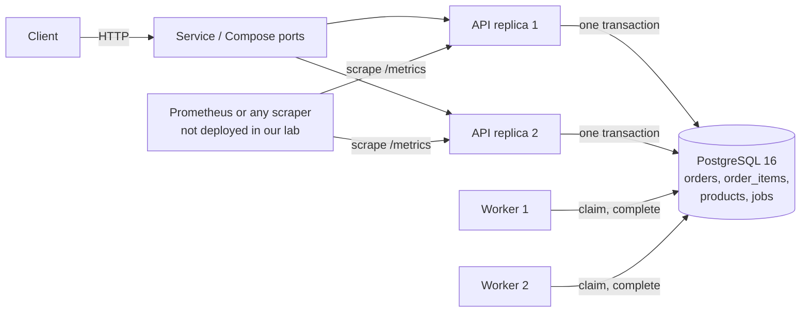

# FulfillOps architecture

This page is the one-page overview. The reasons behind each choice are in
[ADR-001](ADR-001.md), the run-time targets are in [ADR-003](ADR-003.md), and the risks are in
[threat-model.md](threat-model.md).

## 1. Components

| Part | What it does | Where |
|------|--------------|-------|
| API | Validates the request, accepts the order and reserves the stock in one transaction, serves the receipt, health probes and `/metrics` | `src/fulfillops/api/` |
| Worker | Claims a job, does the work, completes the order or retries with backoff, marks the job `dead` when attempts run out | `src/fulfillops/worker/` |
| PostgreSQL | The only shared state: the data, the idempotency keys, the stock and the queue | `db/migrations/` |
| Shared code | Connection pool, settings and the migration runner | `src/fulfillops/common/` |

The API and the worker are two commands of one image (`python -m fulfillops.api` and
`python -m fulfillops.worker`). There is no broker: the queue is the `jobs` table (ADR-001, D4).

## 2. Data flow, from request to receipt

The full sequence diagrams are in ADR-001, section 4. In short:

`request` → `validation` → `one transaction (order, items, stock, job)` → `202 queued` →
`worker claim (lease)` → `guarded completion` → `receipt (GET order)` → `metrics`

## 3. The transaction boundary

Accepting an order is one PostgreSQL transaction (READ COMMITTED):

1. Insert the order with `ON CONFLICT DO NOTHING` on the idempotency key (stops duplicates).
2. Insert the order lines (the SKUs are aggregated and sorted first).
3. For each SKU, in sorted order: `UPDATE products SET available = available - qty WHERE sku = ... AND available >= qty`.
   If any update changes no row, the whole transaction rolls back and the answer is 409 `OUT_OF_STOCK`.
4. Insert the `pending` job.
5. `COMMIT`, and only then answer 202.

Completing an order is a second, separate transaction, guarded by the job's worker id and
attempt number, so a worker that lost its lease cannot complete an order twice.

## 4. Data model

| Table | Key points |
|-------|-----------|
| `products` | `sku`, `unit_price_cents`, `available` with `CHECK (available >= 0)` |
| `orders` | `idempotency_key` is `UNIQUE`, `payload_hash` for replay checks, `status` in `queued, processing, completed, failed` |
| `order_items` | one row per SKU after aggregation, `quantity > 0` |
| `jobs` | one job per order, `state` in `pending, claimed, done, dead`, `attempts`, `max_attempts`, `lease_expires_at`, `locked_by`, `next_run_at` |

## 4b. Invariants and where they are enforced

| Rule | Enforced by |
|------|-------------|
| Stock never negative | `CHECK` plus the conditional `UPDATE` |
| One key, one order | `UNIQUE (idempotency_key)` plus `ON CONFLICT DO NOTHING` |
| Same key, different body is refused | stored payload hash, 409 `IDEMPOTENCY_CONFLICT` |
| An order is never completed twice | guarded completion (worker id and attempt number) |
| A committed order cannot vanish | one transaction, plus lease expiry so another worker can claim the job |
| A failing job stays visible | after 5 attempts the job is `dead`, the order `failed`, stock stays reserved |

## 5. Reliability behaviour

- **Retries:** 5 attempts, backoff about 2, 4, 8 and 16 s with plus or minus 25 % jitter, capped at 30 s.
- **Lease:** 10 s, measured with the database clock. A worker that dies loses its jobs to another worker.
- **Shutdown:** the API drains for up to 20 s on SIGTERM. Compose and Kubernetes give 30 s.
- **Health:** `/health/live` and `/health/ready` on the API. The worker has no HTTP port.

## 6. Observability

`/metrics` (Prometheus format) exposes order, failure and retry totals (read from the database
at scrape time), HTTP request counters and a latency histogram for the p95. The worker has no
metrics port. The targets (99.5 % success, p95 under 300 ms) are in ADR-003.

## 7. Deployment

| Environment | How |
|-------------|-----|
| Local | `docker compose up -d --build`: `db`, `api-1`, `api-2`, `worker-1`, `worker-2` |
| CI | GitHub Actions: lint, tests, image build, SBOM, vulnerability scan |
| Cluster | kind with 2 API replicas, 2 worker pods and PostgreSQL on a persistent volume, reconciled by Argo CD from `infra/k8s` on `main` |

## 8. Security basics

No secrets in Git (`.env.example` holds placeholders only). Containers run as a non-root user
with a read-only filesystem and no extra capabilities. Request bodies are limited to 16 KiB and
every field is validated. The reset script refuses to run unless `APP_ENV=test` and `--yes`.
The threat list is in [threat-model.md](threat-model.md).
