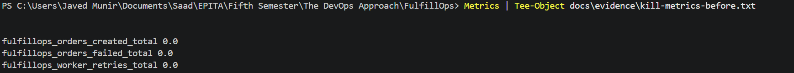
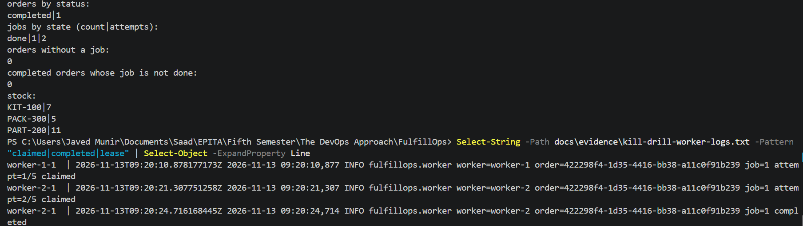
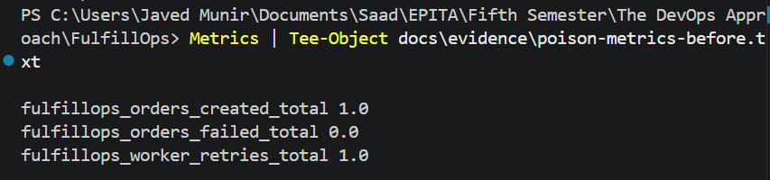
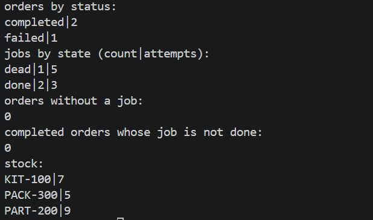

# Incident postmortem (blameless)

Status: DRAFT. Fill the brackets from the real drill evidence. Do not write a number or a time
that is not in a log, a metric or a query result you saved.

A postmortem explains what happened and how the system and the team can do better. It does not
look for a person to blame. Both incidents below are controlled failures, injected on purpose in
our isolated test environment.

## Incident 1: a worker is killed while processing a committed order (owner: Person B)

**Summary.** During the Compose drill, `worker-1` was killed with `docker kill` (SIGKILL) while it
held the lease on order `422298f4-1d35-4416-bb38-a11c0f91b239` (job 1, attempt 1 of 5, processing
time raised to 5 s). `worker-2` claimed the same job after the lease expired (attempt 2 of 5) and
completed the order.

**Impact.** One order was delayed by about one lease period (10 s) plus processing time. Orders
lost: 0 (1 of 1 completed). Stock: PART-200 went from 12 to 11, so one unit was reserved once.

**Timeline (UTC, from the container logs; times are approximate to about 2 s, see the limits).**
| Time | Event | Source |
|------|-------|--------|
| 09:20:10.9 | worker-1 claims job 1, attempt 1/5 | `kill-drill-worker-logs.txt` |
| about 09:20:14 | worker-1 killed with `docker kill` (host clock) | `kill-time.txt` |
| about 09:20:21 | lease expires, worker-2 claims job 1, attempt 2/5 | `kill-drill-worker-logs.txt` |
| 09:20:24.7 | worker-2 completes the order | `kill-drill-worker-logs.txt` |

**Detection.** `fulfillops_worker_retries_total` went from 0 to 1 (`kill-metrics-before.txt` and
`kill-metrics-after.txt`). The job row shows `attempts = 2`. The logs show attempt 1 and attempt 2
by different workers.

**Root cause.** A worker process was terminated while holding a lease. By design the job can be
claimed again once the 10 s lease has expired.

**Contributing factors.** A fixed 10 s lease without renewal; polling every 0.5 s; processing
time raised to 5 s so that the kill had a window; the killed container's restart policy was set to
`no` (`docker update --restart=no`) so that the takeover by the other worker is visible.

**Recovery.** Automatic, no manual step. About 10 s from the first claim to the second (the
lease), then the processing time.

**Data integrity (`kill-integrity.txt`).** Orders: 1 completed. Jobs: 1 done, 2 attempts in total.
Orders without a job: 0. Completed orders whose job is not done: 0. Stock: KIT-100 7, PACK-300 5,
PART-200 11. The order completed once and the stock was reserved once.

**What went well.** The order was not lost and no human action was needed. The logs show which
worker held the job and when.

**What went badly or was lucky.** Recovery time is bounded below by the lease (about 10 s). No
alert fired. `worker_retries_total` also counts crash recoveries, not only failed attempts. Docker
Desktop's VM clock differs from the host clock by up to about a second and can step, so durations
taken from log timestamps are approximate; the order of events and the attempt counts are reliable,
and the lease itself is judged by the database clock.

**Action items.**
| Action | Owner | Priority |
|--------|-------|----------|
| Renew the lease while the worker is alive (heartbeat) | B | later |
| Alert when `fulfillops_orders_failed_total` increases | B/C | later |
| Take drill timestamps from one clock source | B | next drill |

**Screenshots (Incident 1, worker kill).**

Before the drill (metrics at 0 created, 0 failed, 0 retries):



After recovery (order completed by the second worker, 1 retry counted):



### Incident 1b: poison job (same drill session)

**Summary.** Orders from customer `POISON-DEMO` always fail in the worker (`POISON_CUSTOMER_ID`, honoured
only outside production; here `APP_ENV=development`). Order `f5306a81-a2ee-48df-9070-038a7b247b19`
was tried 5 times (workers `worker-2`, `worker-1`, then `worker-2` three times) with waits of 2.1,
4.6, 7.1 and 18.8 s, and ended `failed` with the job `dead`, about 33 s after the first claim.
The stock stayed reserved, and the next normal order completed.

**Evidence.** `poison-progress.txt` (attempts 1 to 5, ending `failed|dead|5`), `poison-sql.txt`
(job `dead`, attempts 5, `last_error` `PoisonJobError: poison job: this order always fails`),
`poison-metrics-before.txt` and `poison-metrics-after.txt` (`orders_failed_total` 0 to 1,
`worker_retries_total` 1 to 5), `poison-drill-worker-logs.txt` (five claims, four retries, one
`dead`), `after-poison-order.txt` (normal order `completed`), `poison-integrity.txt` (orders
completed 2, failed 1; jobs dead 1 with 5 attempts, done 2 with 3 attempts; PART-200 stock 9).

**Why it is safe.** The retry count is bounded (5), waits grow (about 2, 4, 8, 16 s with jitter),
the failure stays visible (`failed`, `last_error`, metric), the stock is not released automatically,
and other orders are not blocked.

**Limits.** The poison customer is a test device (an environment variable); real failures are
usually transient (a downstream timeout) or permanent (bad data), and we do not tell them apart.
There is no alert, and nobody is told that a job is `dead`.

**Screenshots (Incident 1b, poison job).**

Before the drill (1 created, 0 failed, 1 retry from the kill drill):



After the drill (job dead after 5 attempts, 2 created, 1 failed, 5 retries):



## Incident 2: failed API rolling release (owner: Tony, with Makuo)

**Summary.** [A revision with `FAIL_READINESS=true` was pushed to Git; Argo CD synced it; the new
pods never became ready; the rollout stopped; the old pods kept serving.]
**Timeline (UTC).** [Commit of the bad revision, Argo CD sync, new pods not ready, probe CSV showing
the old pods answering, `git revert`, Argo CD sync, new healthy revision.]
**Impact.** [Requests failed during the rollout: from the 30 s probe CSV, expected 0.]
**Root cause.** [A deliberately unhealthy revision.]
**Detection.** [`/health/ready` returns 503, pods `0/1 Ready`, Argo CD Progressing or Degraded.]
**Recovery.** [Git revert; Argo CD restored the last good revision; committed orders were not lost.]
**Action items.** [Owner: Tony.]

## Evidence index
| Item | File |
|------|------|
| Compose stack, public checker (15 passed, 0 failed, 0 skipped) | `docs/evidence/compose-checker.txt` |
| Incident 1, worker logs | `docs/evidence/kill-drill-worker-logs.txt` |
| Incident 1, metrics before and after | `docs/evidence/kill-metrics-before.txt`, `docs/evidence/kill-metrics-after.txt` |
| Incident 1, drill timeline | `docs/evidence/kill-time.txt`, `docs/evidence/kill-progress.txt` |
| Incident 1, SQL snapshots | `docs/evidence/kill-sql-before.txt`, `docs/evidence/kill-sql-after.txt`, `docs/evidence/kill-integrity.txt` |
| Incident 1, screenshots | `docs/evidence/screenshots/kill-before.png`, `docs/evidence/screenshots/kill-after.png` |
| Incident 1b, worker logs | `docs/evidence/poison-drill-worker-logs.txt` |
| Incident 1b, metrics before and after | `docs/evidence/poison-metrics-before.txt`, `docs/evidence/poison-metrics-after.txt` |
| Incident 1b, order, job row and timeline | `docs/evidence/poison-order.txt`, `docs/evidence/poison-sql.txt`, `docs/evidence/poison-progress.txt`, `docs/evidence/poison-time.txt` |
| Incident 1b, queue not blocked | `docs/evidence/after-poison-order.txt` |
| Incident 1b, SQL integrity | `docs/evidence/poison-integrity.txt` |
| Incident 1b, screenshots | `docs/evidence/screenshots/poison-before.png`, `docs/evidence/screenshots/poison-after.png` |
| Latency (p95), local run | `docs/evidence/p95-20261112T022346Z.json`, `docs/evidence/p95-20261112T022346Z-samples.csv` |
| Latency (p95), Compose containers | `docs/evidence/p95-[timestamp].json` and `-samples.csv` (after the run) |
| Incident 2, 30 s rollout probe CSV | `docs/[ ]` (Person C) |
| Incident 2, Argo CD screenshots, rollout history, Git revisions | `docs/evidence/[ ]` (Person C) |

## Queries for the data-integrity checks
```sql
-- orders and jobs by state
SELECT status, count(*) FROM orders GROUP BY status ORDER BY 1;
SELECT state, count(*) AS jobs, sum(attempts) AS attempts FROM jobs GROUP BY state ORDER BY 1;

-- no committed order without a job; no completed order whose job is not done
SELECT count(*) AS orders_without_job
FROM orders o LEFT JOIN jobs j ON j.order_id = o.id WHERE j.id IS NULL;
SELECT count(*) AS completed_but_job_not_done
FROM orders o JOIN jobs j ON j.order_id = o.id WHERE o.status = 'completed' AND j.state <> 'done';

-- stock check: seed minus available must equal everything ever reserved (failed orders keep theirs)
SELECT p.sku, p.available, coalesce(sum(i.quantity), 0) AS reserved
FROM products p LEFT JOIN order_items i ON i.sku = p.sku GROUP BY p.sku, p.available ORDER BY 1;
```
